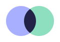
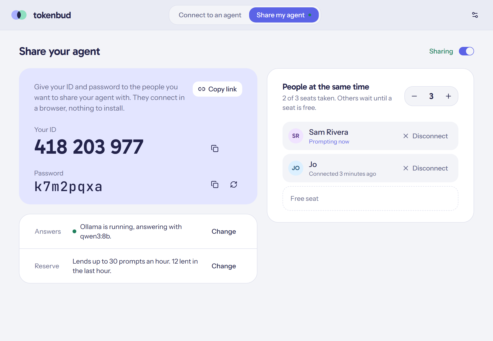
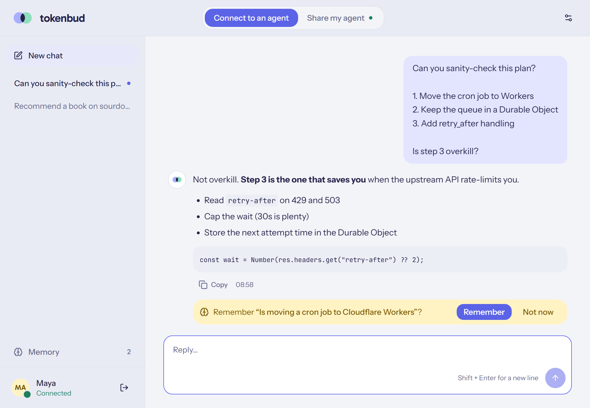
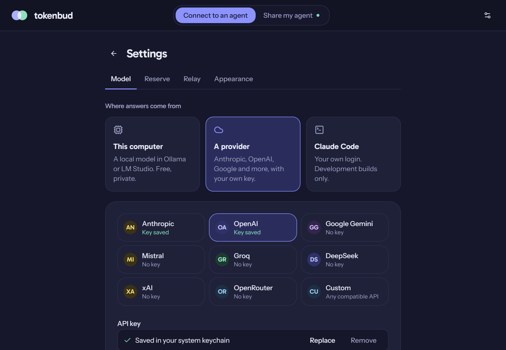

<div align="center">



# tokenbud

**Share your AI the way you share your screen.**

Give someone an ID and a password, and they can chat with the model on your computer or your API account. Your keys and your files never leave your machine.

[](LICENSE)
[](../../releases/latest)
[](https://tauri.app)
[](https://www.rust-lang.org)
[](https://workers.cloudflare.com)
[](#where-answers-come-from)

[**Download**](../../releases/latest) · [How it works](#how-it-works) · [Run your own relay](#run-your-own-relay) · [Build from source](#build-from-source)



</div>

---

You have a good model running on your desktop, or an API key your teammates keep asking about. They don't need your login and you don't want to hand it over. You'd just like them to be able to *ask*.

**tokenbud** turns that into a two-minute job. Open it, choose **Share my agent**, and read out an ID and a password. The other person types them into tokenbud, or into a web page with nothing to install, and chats with your AI. You decide how many people can use it at once and how much you lend, and you can disconnect anyone with one click. Nothing on your side opens a port; nothing on their side sees a key.

## Highlights

- **TeamViewer-simple.** A 9-digit ID and a password. A new password disconnects everyone.
- **Seats you control.** Choose how many people can prompt at the same time; everyone else waits for a free seat.
- **A reserve that protects you.** Lend at most N prompts an hour. Sharing pauses on its own, and people see when it resumes.
- **Your model, your choice.** A local model in Ollama or LM Studio, or your own key for Anthropic, OpenAI, Google Gemini, Mistral, Groq, DeepSeek, xAI, OpenRouter, or any OpenAI-compatible API.
- **Nothing to install for guests.** The relay also serves a web client, and the desktop app does the same job.
- **Local-first memory.** Chats and the facts you want the agent to know stay on your device, and are sent along only while you're connected.
- **Agent to agent.** `tokenbud mcp` lets your own agent (Claude Code or any MCP client) prompt a shared one.
- **Light and dark,** with a calm, flat look.

<table>
  <tr>
    <td width="50%"></td>
    <td width="50%"></td>
  </tr>
  <tr>
    <td align="center"><sub>Chat with someone's agent. It can suggest facts to remember, and nothing is saved until you say so.</sub></td>
    <td align="center"><sub>Pick what answers: a local model, or a provider with your own key.</sub></td>
  </tr>
</table>

## How it works

```
 guest (app or browser) ──HTTPS──▶  relay  ◀──WebSocket── tokenbud (host) ──▶ your model
                         ◀─answer──  Cloudflare Worker      ──answer───────▶   local or API
```

1. **The host app connects out** to a small relay on Cloudflare and gets an ID. No open ports, no port forwarding, works behind any router.
2. **A guest opens a session** with the ID and password. The relay checks the password (it only stores a hash) and gives them a seat if one is free.
3. **Prompts travel through the relay** to the host, which answers with its model and sends the answer back. Finished prompts are deleted from the relay after 10 minutes.

Each host has its own Durable Object on the relay. It holds the password hash, the seat count and the live sessions, and nothing else.

## Download

Get the latest installer for Windows, macOS or Linux from [**Releases**](../../releases/latest).

The builds are not code-signed yet, so Windows SmartScreen and macOS Gatekeeper ask for confirmation the first time.

## Use it

### Share (host mode)

Open tokenbud and click **Share my agent**. Sharing starts right away and shows your ID and password.

- **People at the same time:** set the number of seats (1–50, default 3). You see who's connected and who's prompting, and can disconnect anyone.
- **Copy link** gives guests the web client with your ID filled in; they only type the password.
- **↻** makes a new password and disconnects everyone. The switch at the top stops sharing.

### Connect (client mode)

Click **Connect to an agent**, or open the relay's address in a browser. Enter the ID and password and start chatting. Start as many chats as you like; follow-ups keep their context. Closing the window or tab gives your seat back.

### Settings

The ⚙ button opens Settings:

- **Model.** Where answers come from (see below).
- **Reserve.** Lend at most N prompts an hour (default 30, rolling). It also shows what you've lent.
- **Relay.** tokenbud's public relay, or your own.
- **Appearance.** Light, dark, or match the system.

The window opens at one size for both modes, remembers the size and position you leave it at, and the layout adapts to the width.

### Where answers come from

| Choice | What it uses | Notes |
|---|---|---|
| **This computer** | [Ollama](https://ollama.com), [LM Studio](https://lmstudio.ai), or any OpenAI-compatible server | Found automatically on their usual ports. Free and private. |
| **A provider** | Anthropic, OpenAI, Google Gemini, Mistral, Groq, DeepSeek, xAI, OpenRouter, or Custom | Your own API key, one per provider, kept in the OS keychain. The model list comes from the provider. |
| **Claude Code** | Your own Claude Code login | Development builds only, for testing on your own machine. See [Using it within the rules](#using-it-within-the-rules). |

Answers from reasoning models arrive without their `<think>` sections.

### Memory

Your chats and a short list of facts about you ("Writes Rust", "Prefers short answers") are kept **only on your device**: in the app's config folder, or in the browser's IndexedDB.

- **Facts travel with each prompt** to the agent you're connected to, so it answers knowing you.
- **The agent can suggest a fact**, which appears as a **Remember / Not now** chip.
- **Open Memory** in the sidebar to add, edit or delete facts, or to switch memory off.

### Your own agent, over MCP

The same executable is also an MCP server, so Claude Code or any MCP client can prompt a shared agent:

```bash
claude mcp add tokenbud -e TOKENBUD_ID=418203977 -e TOKENBUD_PASSWORD=k7m2pqxa -- tokenbud mcp
```

It adds one tool, `ask(prompt)`. Each call takes a seat only while it runs.

## Run your own relay

tokenbud uses a public relay by default. It's free and best effort. You can run your own on Cloudflare's free plan in a few minutes, and then only the people you choose share it.

**You need** a free [Cloudflare account](https://dash.cloudflare.com/sign-up) and [Node.js](https://nodejs.org) 20 or later.

```bash
git clone <this repository> tokenbud
cd tokenbud/desktop && npm install      # the web client is built from here
cd ../relay && npm install
npx wrangler login                      # opens the browser once
npm run deploy                          # builds the web client, then deploys the Worker
```

The deploy prints your relay's address, such as `https://tokenbud-relay.<you>.workers.dev`. Then:

1. In tokenbud, open **Settings → Relay**, choose **My own relay**, paste the address, and click **Use this relay**. The app checks that it's a tokenbud relay before switching.
2. Everyone you share with, and everyone you connect to, has to use the same relay. Guests can also simply open the relay's address in a browser.
3. You get a separate ID on each relay. Your ID on the public relay is kept.

Good to know:
- **Free plan limits.** The Workers free plan allows about 100,000 requests a day. A connected guest checks in about every 15 seconds, so that's roughly 15 to 20 people connected all day. The $5 paid plan removes the worry.
- **Custom domain.** Add one in the Cloudflare dashboard if you'd like a nicer address.
- **Environment override.** `TOKENBUD_RELAY=https://…` overrides the setting, which is handy for scripts and testing.
- **Updates.** Run `npm run deploy` again after updating tokenbud.

To make your relay the default in builds you hand out, change `DEFAULT_RELAY_URL` in `crates/tokenbud-core/src/lib.rs`.

## Build from source

You need Rust (stable) and Node.js 20 or later. On Linux, also the [Tauri prerequisites](https://v2.tauri.app/start/prerequisites/).

```bash
cd desktop && npm install && npm run build && cd ..
cargo build --release
```

The app is `target/release/tokenbud`. To make installers, run `npm run bundle` in `desktop/`. For a release on GitHub, push a version tag: the [release workflow](.github/workflows/release.yml) builds Windows, macOS and Linux installers and attaches them to a draft release.

```bash
git tag v0.1.0 && git push origin v0.1.0
```

## Using it within the rules

tokenbud never sees or moves a credential. But model providers decide what their accounts may be used for, so here's how each choice fits:

- **Local models** involve no provider at all.
- **Provider keys** are meant for building on, including for other people. You're responsible for how your key is used, and providers forbid reselling access, so share, don't sell.
- **Claude subscriptions** (Free, Pro, Max) are for individual use. Anthropic's terms don't allow answering other people's prompts with them. That's why the Claude Code engine exists only in development builds. To share Claude, use an Anthropic API key.

## Security and privacy

- The relay stores only SHA-256 hashes of host secrets, passwords and session tokens. Ten wrong passwords in a minute pause connections to that host.
- The relay sees prompts and answers in transit and deletes finished ones after 10 minutes. Run your own relay if that matters to you.
- Keys and secrets live in the OS keychain (Windows Credential Manager, macOS Keychain, Linux keyring).
- With a local model, prompts never leave the two computers and the relay.

## Project layout

| Path | What it is |
|---|---|
| `apps/desktop` | **tokenbud**, the desktop app (Tauri 2): host and client modes, and `tokenbud mcp` |
| `apps/tokenbud-host` | Sharing: the relay connection, seats, the reserve, and the model engines |
| `apps/tokenbud-client` | Connecting by ID and password, and the MCP server |
| `crates/tokenbud-core` | Wire types, relay client, settings and keychain storage |
| `relay/` | The Cloudflare Worker: web client at `/`, API at `/v1` |
| `desktop/` | All the UI: React, Tailwind and shadcn/ui. `src/app` is the desktop window, `src/web` the browser client |

<details>
<summary><b>Development</b></summary>

```bash
cd relay && npm run dev           # relay + web client on :8787
cd desktop && npm run app         # the desktop app with hot reload
cd desktop && npm run dev:web     # web client with hot reload on :1422 (proxies /v1 to :8787)
cd desktop && npm run preview:ui  # the app's UI in a browser with sample data
```

Run the app against the local relay with `TOKENBUD_RELAY=http://127.0.0.1:8787`.
- `TOKENBUD_HOME=/some/dir` keeps an instance's settings in that folder, so several can run on one machine.
- `cargo run -p tokenbud-host --example share` shares from a terminal and prints the ID and password. It's useful for testing without the window.

In the UI preview, `?steps=host,settings:model` clicks through to a screen, `?theme=dark` forces dark mode, and `?connect=1` shows the connect screen. The README screenshots are taken that way.

</details>

<details>
<summary><b>Relay API</b></summary>

| Method and path | Auth | Purpose |
|---|---|---|
| `POST /v1/hosts` | none | New host: returns `host_id` (9 digits) and `host_secret`. |
| `GET /v1/hosts/:id/connect` (WebSocket) | host secret | The host's channel. |
| `POST /v1/hosts/:id/sessions` `{password, name}` | none | Take a seat. Returns `session_token`. 401 wrong password, 409 no free seat, 503 not sharing. |
| `DELETE /v1/hosts/:id/sessions` | session | Leave. |
| `GET /v1/hosts/:id/ping` | session | Keep the seat (every 15 s; 45 s without one ends the session). Returns `online` and `paused`. |
| `POST /v1/hosts/:id/ask` `{prompt, history, context?}` | session | Send a prompt. `context` carries the guest's memory (at most 10,000 characters). 409 if one is already running, 503 while paused. |
| `GET /v1/hosts/:id/jobs/:job?wait=25` | session | The answer, with long-polling. |
| `GET /health` | none | `{"service": "tokenbud-relay"}` |

On the WebSocket:
- **The host sends** `config {password, seats, name}`, `pause {paused}`, `kick {session_id}` and `result {job_id, status, text?, error?}`.
- **The relay sends** `sessions`, `job` and `cancel`.

</details>

## Contributing

tokenbud is a hobby project, maintained when time allows. Issues and pull requests are welcome; small and focused ones are easiest to review. Please run `cargo check --workspace` and `npx tsc --noEmit` in `desktop/` and `relay/` before sending a change.

## License

[MIT](LICENSE). Model providers' own terms still apply to the keys and accounts you use with it.
